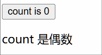

## 1. 导读

条件渲染类似于 vue 中的 v-show、v-if，不过在 react 中，条件渲染是通过纯 js 结合 jsx 语法来实现的。

在 React 中没有类似 vue 中的 v-if、v-else、v-show 的条件渲染指令，React 中的条件渲染是通过在 JSX 使用原始的 JavaScript 条件逻辑来决定要渲染什么内容的，写起来更加原生，更加直观、更加灵活。

## 2. “条件渲染”是什么？

- 条件渲染是指根据特定条件来决定是否渲染某个组件或元素的过程
- 在 React 中，通过 JavaScript 的条件语句（如 if、三元运算符、逻辑 &&）来实现条件渲染
- 允许根据应用状态或 props 动态控制 UI 的显示内容

## 3. React 中的条件渲染

[点击查看 react 官方文档关于 Conditional rendering 条件渲染的说明][1]

React 没有特殊的语法来编写条件语句，因此你使用的就是普通的 JavaScript 代码。例如使用 if 语句根据条件引入 JSX：

```jsx
let content;
if (isLoggedIn) {
  content = <AdminPanel />;
} else {
  content = <LoginForm />;
}
return <div>{content}</div>;
```

如果你喜欢更为紧凑的代码，可以使用 [条件 ? 运算符][2]。与 if 不同的是，它工作于 JSX 内部：

```jsx
<div>{isLoggedIn ? <AdminPanel /> : <LoginForm />}</div>
```

当你不需要 else 分支时，你也可以使用更简短的 [逻辑 && 语法][3]：

```jsx
<div>{isLoggedIn && <AdminPanel />}</div>
```

所有这些方法也适用于有条件地指定属性。如果你对 JavaScript 语法不熟悉，你可以先使用 `if...else`。

## 4. 示例 1 - 条件渲染示例

```jsx {17} [1.jsx]
import { StrictMode } from 'react'
import { createRoot } from 'react-dom/client'
import { useState } from 'react'

function App() {
  const [count, setCount] = useState(0)

  return (
    <>
      <p>
        <button onClick={() => setCount((count) => count + 1)}>
          count is {count}
        </button>
      </p>
      {/* 测试 - 条件渲染 - 根据当前 count 的值来决定渲染不同的内容 */}
      <div>
        {count % 2 === 0 ? <div>count 是偶数</div> : <div>count 是奇数</div>}
      </div>
    </>
  )
}

createRoot(document.getElementById('root')).render(
  <StrictMode>
    <App />
  </StrictMode>
)
```



## 5. 示例 2 - `&&` 左侧避免数字 `0`

逻辑与 `&&` 运算中的数字 `0`：

```ts
0 && "hello world" // 0
123 && "hello world" // "hello world"
```

React 会渲染数字 `0`，所以 `0 && JSX` 会显示 `0`，应先把数字条件转换成明确的布尔表达式。

```ts {7-8}
import { StrictMode } from 'react'
import { createRoot } from 'react-dom/client'

function MessageCount({ count }: { count: number }) {
  return (
    <main>
      <p>错误写法的结果：{count && <b>{count} 条消息</b>}</p>
      <p>正确写法：{count > 0 && <b>{count} 条消息</b>}</p>
    </main>
  )
}

createRoot(document.getElementById('root')!).render(
  <StrictMode>
    <MessageCount count={0} />
  </StrictMode>,
)
```

 {w=165px}

 {w=768px}

## 6. 对比 vue 中的 `v-if` 和 `v-show`

在 vue 中，有俩内置指令「v-if 和 v-show」来控制元素的显示、隐藏。它们是用来做条件渲染用的，当条件满足时才会渲染对应的内容。

在 react 中，并不存在类似的概念，由于 react 中的组件模板（html 标签）是通过 JSX 语法，直接跟 js 写在一起的，并不像 vue 那样，将 template 和 script 分离，所以在 react 中，对于条件渲染的处理逻辑会更加灵活，走 js 那套就行，无论是使用 if 语句还是三目运算符还是逻辑短路的写法，都是 ok 的。

## 7. 引用

- [react 快速入门 - 条件渲染][1]
- [MDN - 条件（三元）运算符][2]
- [MDN - 逻辑与（&&）][3]

[1]: https://zh-hans.react.dev/learn#conditional-rendering
[2]: https://developer.mozilla.org/zh-CN/docs/Web/JavaScript/Reference/Operators/Conditional_operator
[3]: https://developer.mozilla.org/zh-CN/docs/Web/JavaScript/Reference/Operators/Logical_AND#short-circuit_evaluation
