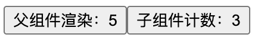
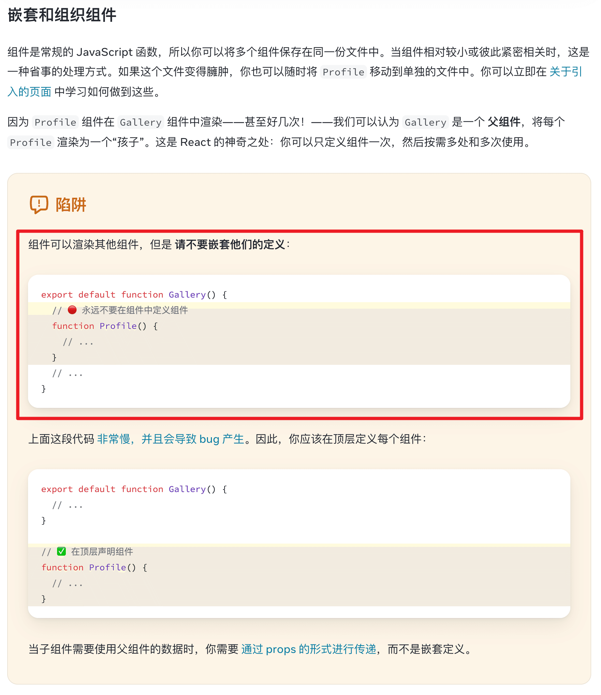

## 1. 导读

在组件函数体内定义子组件会导致重渲染时重建，引发 state 重置等问题。

组件应定义在模块顶层。若在父组件函数内定义，父组件每次渲染都会产生新的组件类型并重置其 state。

## 2. 示例 1 - 禁止在组件内定义组件

```tsx
import { StrictMode, useState } from 'react'
import { createRoot } from 'react-dom/client'

// ✅ 正确做法
// 组件应定义在模块顶层
// 顶层定义能让 React 持续识别为同一组件类型
function Counter() {
  const [count, setCount] = useState(0)
  return (
    <button onClick={() => setCount(count + 1)}>子组件计数：{count}</button>
  )
}

function App() {
  const [parentCount, setParentCount] = useState(0)

  // ❌ 错误做法
  // 不要在这里声明 Counter
  // 若在父组件函数内定义，父组件每次渲染都会产生新的组件类型并重置其 state。
  // function Counter() {
  //   const [count, setCount] = useState(0)
  //   return (
  //     <button onClick={() => setCount(count + 1)}>子组件计数：{count}</button>
  //   )
  // }

  return (
    <main>
      <button onClick={() => setParentCount(parentCount + 1)}>
        父组件渲染：{parentCount}
      </button>
      <Counter />
    </main>
  )
}

createRoot(document.getElementById('root')!).render(
  <StrictMode>
    <App />
  </StrictMode>,
)
```

 {w=219px}

## 3. 查看官方文档对此的描述

 {w=922px}

## 4. 引用

- [React 官方文档 - 你的第一个组件][1]

[1]: https://zh-hans.react.dev/learn/your-first-component
